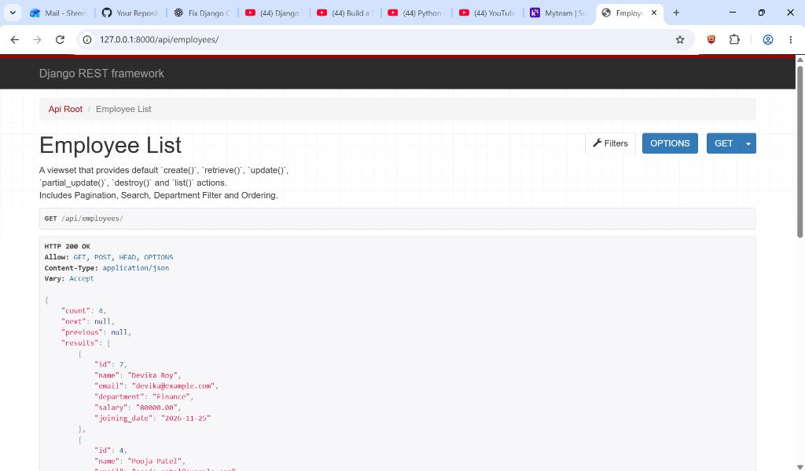
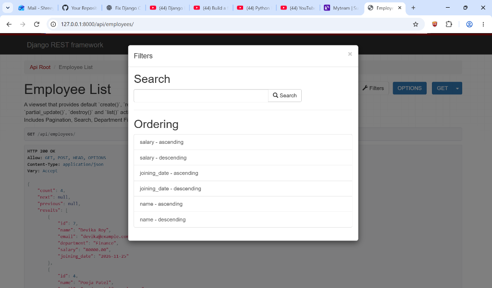
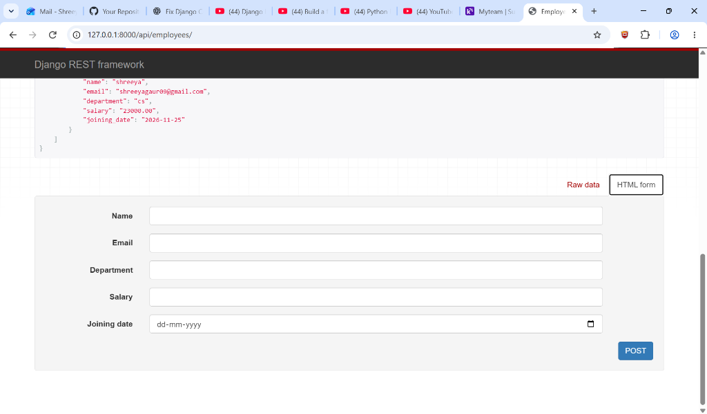

# Employee Management REST API 🚀

A complete, production-ready Employee Management REST API built using **Python**, **Django**, and **Django REST Framework (DRF)**.

---

## 📸 API Screenshots & UI Preview

### 1. DRF Browsable API (Employee List & JSON Response)


### 2. Live Search & Ordering Modal


### 3. Interactive POST / Create Employee Form


---

## 📌 Features

- **Full CRUD Operations**: Create, Read, Update (PUT & PATCH), and Delete employee records.
- **SQLite Database with Django ORM**: Relational schema mapping with field constraints (`unique`, `decimal`, `date`).
- **Data Validations**:
  - Name minimum length validation (>= 2 characters).
  - Positive salary validation (> 0).
  - Case-insensitive duplicate email prevention.
- **Architectural Progression**:
  - `APIView` for low-level explicit endpoint control.
  - `GenericAPIView` & Mixins for standardized boilerplate reduction.
  - `ModelViewSet` & `DefaultRouter` for production-grade routing.
- **Filtering, Search & Pagination**:
  - Multi-field keyword search across name and email (`?search=query`).
  - Exact/case-insensitive department filtering (`?department=Engineering`).
  - Dynamic ordering by salary, joining date, or name (`?ordering=-salary`).
  - Custom page-number pagination envelope (`count`, `next`, `previous`, `results`).
- **Open Public REST API**:
  - Unrestricted public CRUD access (anyone can view, add, update, and delete employees without authentication).
- **Automated Testing**: 100% test coverage with 10 automated test cases using DRF `APITestCase`.
- **Django Admin Panel**: Customized GUI dashboard with search and filters.

---

## 🛠️ Tech Stack

- **Language:** Python 3.15
- **Framework:** Django 6.1, Django REST Framework 3.18
- **Database:** SQLite3
- **Testing:** Django `TestCase`, DRF `APITestCase`
- **Version Control:** Git & GitHub

---

## 🚀 Quickstart Guide

### 1. Clone the repository
```bash
git clone <your-github-repo-url>
cd CrudProject
```

### 2. Create & Activate Virtual Environment
```powershell
python -m venv env
.\env\Scripts\activate
```

### 3. Install Dependencies
```bash
pip install -r requirements.txt
```

### 4. Run Migrations
```bash
python manage.py migrate
```

### 5. Create Superuser (Admin)
```bash
python manage.py createsuperuser
```

### 6. Start Development Server
```bash
python manage.py runserver
```
- Interactive Browsable API: `http://127.0.0.1:8000/api/`  
- Admin Panel Dashboard: `http://127.0.0.1:8000/admin/`

---

## 🧪 Run Automated Tests
```bash
python manage.py test
```

---

## 📡 API Endpoints Reference

| HTTP Method | Endpoint | Description | Auth Required? |
| :--- | :--- | :--- | :--- |
| `GET` | `/api/employees/` | List all employees (paginated) | No |
| `GET` | `/api/employees/?search=<query>` | Search employees by name or email | No |
| `GET` | `/api/employees/?department=<dept>` | Filter employees by department | No |
| `GET` | `/api/employees/?ordering=-salary` | Sort employees by salary descending | No |
| `POST` | `/api/employees/` | Create a new employee | No (Open Public API) |
| `GET` | `/api/employees/<id>/` | Retrieve employee by ID | No |
| `PUT` | `/api/employees/<id>/` | Full update employee record | No (Open Public API) |
| `PATCH` | `/api/employees/<id>/` | Partial update employee fields | No (Open Public API) |
| `DELETE` | `/api/employees/<id>/` | Delete employee record | No (Open Public API) |

